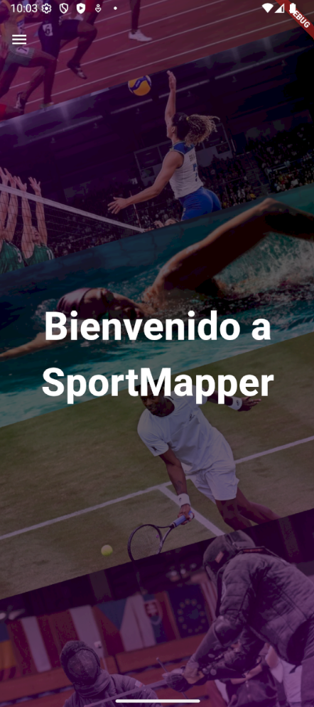
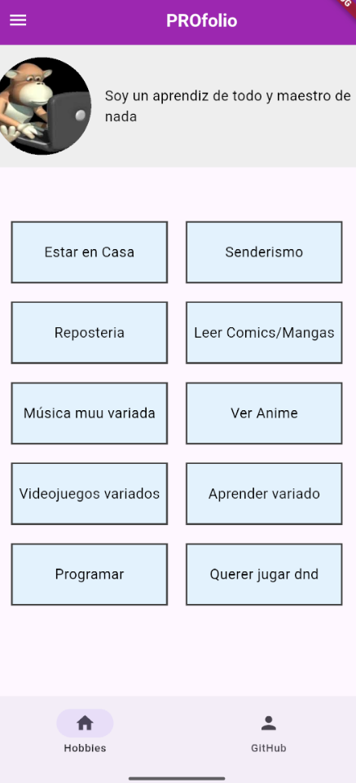
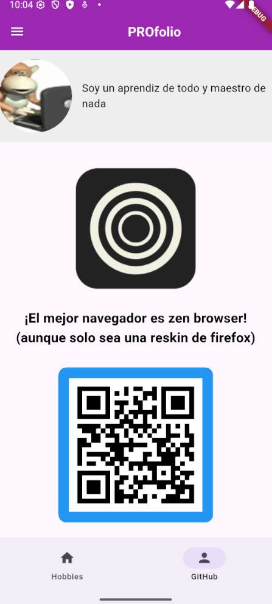
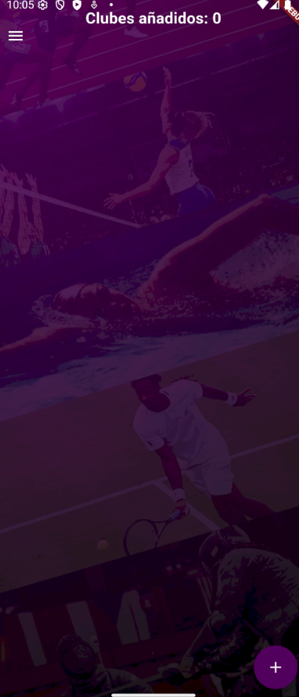
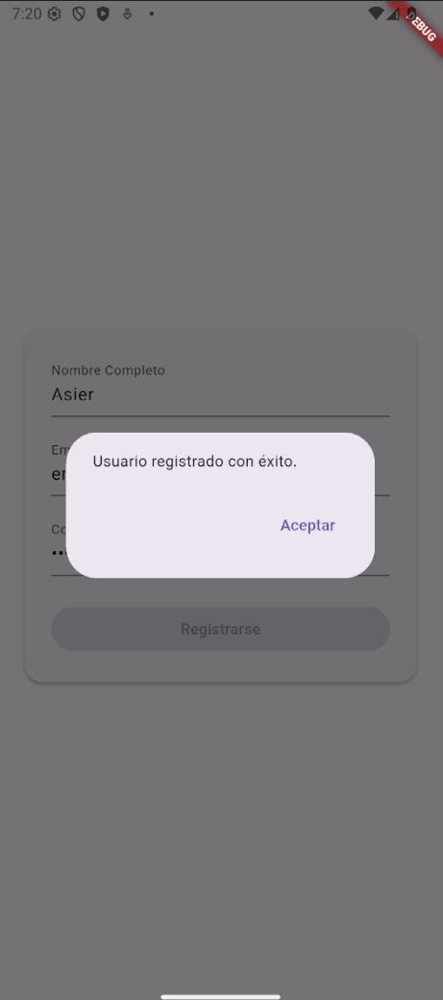
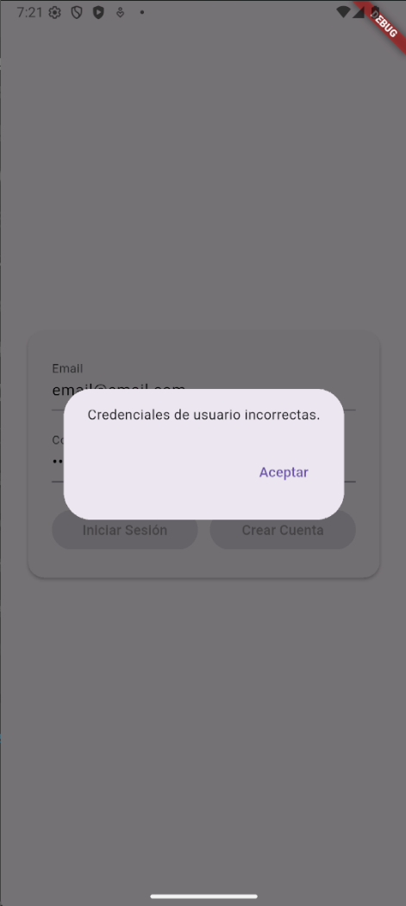
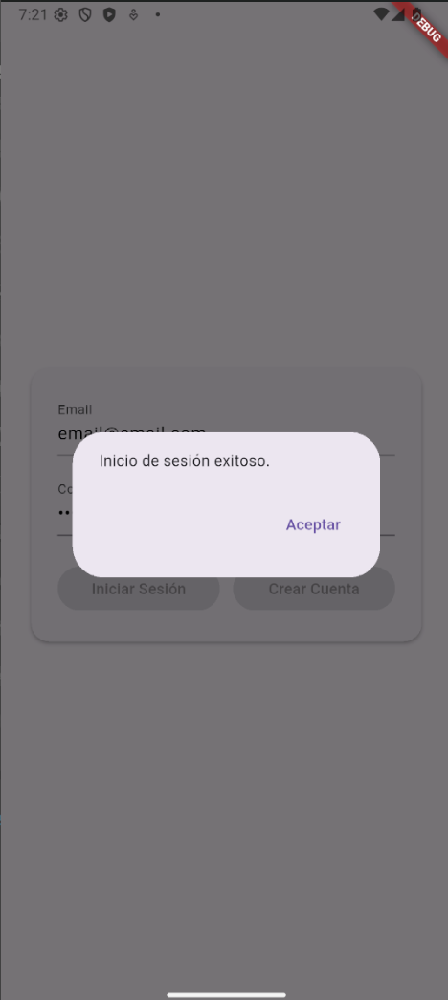
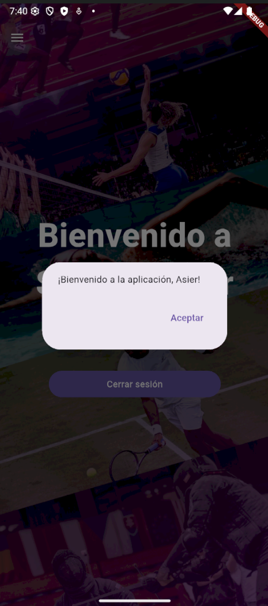

# Proyecto Canario
 
Aplicación móvil desarrollada con **Flutter** para Android. Reúne tres secciones accesibles desde un menú lateral: una página de bienvenida, un portfolio personal y un CRUD de clubes deportivos.
 
## Funcionalidades
 
### Home
Página de bienvenida de la aplicación.
 
### Portfolio
Página con dos pestañas, seleccionables desde una barra de navegación inferior:
 
- **Hobbies**: muestra mis aficiones en una cuadrícula.
- **GitHub**: muestra un código QR que enlaza con mi perfil de GitHub.
### Clubes deportivos (CRUD)
Gestión de clubes deportivos con las cuatro operaciones básicas:
 
- **Crear** nuevos clubes.
- **Leer** el listado de clubes.
- **Eliminar** clubes.
Es la sección añadida más recientemente.
 
## Navegación
 
La navegación entre páginas se realiza mediante un **drawer** (menú lateral) y está gestionada con [`go_router`](https://pub.dev/packages/go_router). La barra superior cambia su título y colores según la página activa.
 
## Tecnologías
 
- [Flutter](https://flutter.dev) 3.50.0
- [Dart](https://dart.dev)
- Paquetes:
  - [`go_router`](https://pub.dev/packages/go_router): enrutado.
  - [`qr_flutter`](https://pub.dev/packages/qr_flutter): generación del código QR.
## Requisitos
 
- Flutter 3.50.0
- Android Studio con un emulador Android o un dispositivo físico con la depuración USB activada
## Instalación y ejecución
 
```bash
git clone URL_DEL_REPOSITORIO
cd proyecto_canario
flutter pub get
flutter run
```
 
- `git clone`: descarga el proyecto.
- `flutter pub get`: instala las dependencias definidas en `pubspec.yaml`.
- `flutter run`: compila y lanza la aplicación en el dispositivo o emulador conectado.
## Plataforma
 
- Android

## Capturas de pantalla








